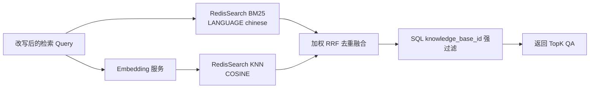

# Redis Stack 混合检索改造报告

日期：2026-07-15  
范围：后端 QA/RAG 检索；不涉及 `web/` 或 `Web-GM-Client`

## 1. 结论

本项目当前更适合使用 **Redis Stack 单库承载 BM25 与向量索引，应用层使用加权 RRF 融合两路排名**：

- BM25 擅长订单号、产品名、规则名、错误码和原问题复现等精确词命中。
- 向量检索擅长口语改写、同义表达和没有共同关键词的语义召回。
- RRF 只依赖两个结果集的名次，不直接混加 BM25 分数与余弦距离，避免量纲和方向不同造成排序失真。
- BM25 与生成 query embedding 并发执行；任何一路暂时失败时使用另一路返回结果。
- Redis Stack 是主运行环境，新增索引使用中文分词，并提高 `question`、`tags` 相对 `answer` 的权重。
- 不增加开关或前端配置；RedisSearch 后端固定采用混合检索，Milvus 保持向量检索。

Redis 8.4 起提供原生 `FT.HYBRID` 和 RRF/LINEAR 融合，但当前现场版本是 Redis `7.4.7`、Search 模块 `2.10.20`，不具备该命令；仓库还使用浮动的 `redis/redis-stack-server:latest`，不同环境版本也可能不一致。因此本次不绑定 `FT.HYBRID`，采用兼容当前 Redis Stack 的两次查询加应用层融合。等生产版本固定并确认不低于 8.4 后，可以评估迁移为单条 `FT.HYBRID`。

## 2. 问题定位

2026-07-14 的提交 `416ed3a`（“检索修改只走向量”）删除了：

- `Store.SearchText` 文本检索接口；
- RedisSearch 的 BM25 查询；
- RAG pipeline 中的文本召回和结果合并逻辑。

提交后的实际链路只剩：query rewrite → embedding → Redis KNN → SQL 知识库过滤 → TopK。其主要问题是：

1. 精确标识符、短关键词和专有名词完全依赖 embedding，容易漏召回。
2. embedding 服务故障会让整次知识检索失败，没有 Redis 本地文本检索兜底。
3. 旧实现也不能原样恢复。旧实现把 BM25 结果整体放在向量结果前面，仅做去重拼接，没有融合两个排序；同时 BM25 默认只取 1 条，结果容易被单路召回支配。

## 3. 改造后的搜索链路



### 3.1 候选数量

每一路候选数为：

```text
candidateLimit = max(topK × 20, 100)
```

当前 `top_k=3`，因此 BM25 和向量各取最多 100 条。扩大候选不是为了把 100 条交给模型，而是为了在 SQL 按知识库强过滤后仍有足够机会得到 3 条有效结果。最终只返回 `top_k` 条。

### 3.2 BM25

RedisSearch 使用 `SCORER BM25` 和 `LANGUAGE chinese`。新建索引的字段权重是：

| 字段 | 类型 | 权重/用途 |
| --- | --- | --- |
| `question` | TEXT | 4；用户问题与标准问法最重要 |
| `tags` | TEXT | 2；产品名、业务词、规则词辅助召回 |
| `answer` | TEXT | 1；答案中出现的关键信息作为兜底 |
| `category` | TAG | 精确过滤元数据，不参与 BM25 |
| `vector_content` | VECTOR | FLOAT32 + COSINE |

用户输入中的 Redis 查询语法字符会先转义，避免括号、冒号、连字符等内容改变查询含义。

### 3.3 向量检索

query 使用现有动态 embedding 模型生成向量，然后执行 RedisSearch KNN/COSINE。向量字段仍使用 `FLOAT32`，不改变现有数据格式和 embedding 配置。

### 3.4 排名融合

采用加权 Reciprocal Rank Fusion：

```text
score(d) = 1.25 / (60 + rank_bm25(d))
         + 1.00 / (60 + rank_vector(d))
```

不存在于某一路的文档，该路贡献为 0。文本侧略高的 `1.25` 权重用于保护客服场景中的编号、专有名词和标准问法精确命中。结果分数再除以“两路都排第 1”的理论最大值，归一化到 `[0,1]`。

这个分数表示融合排名置信度，不是余弦相似度，也不是 BM25 原始分数。被两路共同排在前面的 QA 会自然超过只被一路召回的 QA。

### 3.5 隔离与降级

- 融合后仍调用 SQL 元数据过滤，`knowledge_base_id` 隔离逻辑不变。
- BM25 失败、向量成功：返回向量排名。
- embedding/KNN 失败、BM25 成功：返回 BM25 排名。
- 两路都失败：返回包含两路原因的错误。
- Milvus 不支持本项目中的 BM25 接口，明确返回“不支持文本搜索”，pipeline 自动保持向量模式；不会伪装为混合检索。

## 4. Redis Stack 环境选择

### 4.1 当前规模与索引算法

仓库样例 `data/knowledge/qa.csv` 只有 4 条数据；本机当前 `customer_service_qa` 索引经 `FT.INFO` 确认有 315 条文档、1024 维 FLOAT32/COSINE 向量、FLAT 索引，索引已完成且没有 indexing failure。这个规模继续使用 FLAT 更合适。Redis 官方建议在更大的数据集（文档中给出的参考是超过约 100 万条）或更重视吞吐/可扩展性时使用 HNSW；FLAT 是精确搜索，小中型 QA 库更简单且召回无近似损失。

建议：

- QA 少于约 10 万：继续 FLAT，先用压测数据决定，不为了“向量库”标签盲目切 HNSW。
- 10 万至 100 万：同时压测 FLAT 与 HNSW 的 P95/P99、内存和 Recall@K。
- 超过 100 万或延迟明显不达标：采用 HNSW，并用业务评测集调 `M`、`EF_CONSTRUCTION`、`EF_RUNTIME`。

### 4.2 为什么暂不使用原生 FT.HYBRID

Redis 官方的 `FT.HYBRID` 从 Redis Open Source 8.4.0 开始提供，可在服务端直接组合文本搜索、VSIM 和 RRF/LINEAR。它是版本统一后的优选演进方向，但本次环境有两个现实限制：

1. `deployments/docker-compose.yml` 使用 `redis/redis-stack-server:latest`，不能保证开发、测试和生产使用同一版本。
2. 本机实际占用 `6379` 的 `redis-stack` 容器为 Redis `7.4.7`、Search 模块 `2.10.20`，版本低于原生 `FT.HYBRID` 要求。

本次应用层 RRF 的优势是可立即落地、易单测、兼容旧 Redis Stack。代价是 Redis 有两次搜索请求；embedding 与 BM25 已并发，实际端到端延迟通常仍由 embedding 网络请求主导。

已在该容器中创建隔离的临时索引，使用与代码相同的 `LANGUAGE chinese`、字段权重和 BM25 scorer，中文查询“退款什么时候到账？”能够正确命中对应 QA；测试完成后已用 `FT.DROPINDEX ... DD` 仅删除临时索引及临时 key。生产索引未被修改。

部署建议把镜像从 `latest` 固定到经过验证的具体版本，并在升级后记录：Redis 版本、Search 模块版本、索引算法、向量维度和 embedding 模型版本。

## 5. 旧索引迁移

代码只会在“新建索引”时应用中文分词和新字段权重。RedisSearch 不能用 `FT.ALTER` 修改既有 TEXT 字段权重或索引默认语言，因此已有 `customer_service_qa` 索引需要重建一次。

现场 `FT.INFO` 已确认旧索引的 `question`、`answer`、`tags` 权重均为 1；这与新 schema 的 4/1/2 不同。当前现场向量维度为 1024，迁移前仍应再次核对 active embedding 配置，防止模型已切换但索引尚未重建。

安全重建原则：**删除索引但保留 `cs_qa:*` Hash 数据**。不要使用 `DD`。

维护窗口内执行：

```text
FT.DROPINDEX customer_service_qa
```

随后按当前代码中的 schema 执行 `FT.CREATE`，或在确认 embedding 配置有效后通过现有 `EnsureIndex` 流程创建。因为 Hash 保留，创建索引时 Redis 会扫描 `cs_qa:*` 并重新建立 BM25 与向量索引，不需要重新生成 embedding。

直接创建命令如下，其中 `<DIM>` 必须替换为当前 embedding 模型的实际维度，并且必须与 Hash 中已有向量一致：

```text
FT.CREATE customer_service_qa ON HASH PREFIX 1 cs_qa: LANGUAGE chinese SCHEMA question TEXT WEIGHT 4 answer TEXT WEIGHT 1 category TAG tags TEXT WEIGHT 2 vector_content VECTOR FLAT 6 TYPE FLOAT32 DIM <DIM> DISTANCE_METRIC COSINE
```

生产操作前必须：

1. 备份 Redis 数据；
2. 确认命令没有 `DD`；
3. 在维护窗口执行，因为 drop 与重建之间检索会短暂不可用；
4. 用 `FT.INFO customer_service_qa` 等待 `indexing=0`、`percent_indexed=1`；
5. 用中文精确问法、口语改写、订单号/错误码、无关问题四组样例验收。

如果不重建，向量召回仍可工作，但旧索引按默认 English 建立时，中文 BM25 的分词效果不能保证，无法获得本次完整收益。

## 6. 验证与评测建议

代码级验证：

```powershell
go test ./internal/vectorstore ./internal/graph/rag
go test ./...
```

建议建立至少 100～300 条人工标注查询集，覆盖：

- 标准问法原句；
- 同义改写、口语、省略主语；
- 产品名、型号、错误码、订单/规则编号；
- 多知识库同名问题；
- 明确无答案问题。

核心指标：Recall@20、MRR@3、Top1 命中率、无答案误命中率、P50/P95/P99 延迟。对照实验至少包含“仅 BM25”“仅向量”“混合 RRF”三组，不能只凭几条肉眼样例调权重。

## 7. 后续优化顺序

1. 固定 Redis Stack 版本并完成旧索引中文分词重建。
2. 建立离线标注集，根据 MRR/Top1 调整 1.25:1.0 权重，而不是暴露为前端配置。
3. 数据量增长后，把 `knowledge_base_id` 同步为 Redis TAG，并在 BM25/KNN 查询前置过滤，减少当前“扩大候选 + SQL 强过滤”的开销；SQL 仍保留最终防线。
4. Redis 全环境升级到 8.4+ 后压测原生 `FT.HYBRID ... COMBINE RRF`，若质量一致且延迟更好，再替换应用层双查询。
5. 规模达到压测拐点后再从 FLAT 切 HNSW，不按固定条数机械迁移。

## 8. 官方资料

- [Redis FT.HYBRID](https://redis.io/docs/latest/commands/ft.hybrid/)
- [Redis vector search concepts](https://redis.io/docs/latest/develop/ai/search-and-query/vectors/)
- [Redis FT.CREATE 与中文 LANGUAGE](https://redis.io/docs/latest/commands/ft.create/)
- [Redis 中文检索支持](https://redis.io/docs/latest/develop/ai/search-and-query/advanced-concepts/chinese/)
- [Redis FT.SEARCH](https://redis.io/docs/latest/commands/ft.search/)

## 9. TestServer 实际审计与部署决定

2026-07-15 通过 SSH 别名 `TestServer` 检查，实际环境为：

| 项目 | 实际值 |
| --- | --- |
| Redis 容器 | `redis-stack` |
| Redis | `7.4.7` |
| Search 模块 | `2.10.20` |
| 远端镜像 | `redis/redis-stack@sha256:5d5154123426693540ea6c1d9e638eae2bf2024879c839db6fcfdd7717e817c7` |
| 容器镜像 ID | `sha256:9eafe528d67a445c16ad8981d357ecd9e6f5aa4022992dd94b1de1b08d662559` |
| 端口 | 主机 `6479` → 容器 `6379` |
| 数据目录 | `/root/redis_stack/redis-data` → `/var/lib/redis-stack` |
| 持久化 | AOF 开启；RDB save 规则开启；最近保存成功 |
| 索引 | `customer_service_qa`，375 条，1024 维 FLOAT32/COSINE/FLAT |
| 旧字段权重 | `question=1`、`answer=1`、`tags=1` |

决定：

1. **不升级 Redis 主版本**。375 条数据使用 FLAT 的延迟与精确度优于引入 HNSW；Redis/Search 当前版本已满足两路 `FT.SEARCH`，应用层 RRF 不要求 8.4。
2. **锁定完整镜像 digest**。TestServer 已锁定上述 `redis/redis-stack` digest；仓库开发 compose 锁定同一构建版本对应的 `redis/redis-stack-server@sha256:798ab84d...`，两者均实测为 Redis 7.4.7/Search 2.10.20。
3. **完整重建索引但不重算向量**。先生成独立 RDB 备份，再 `FT.DROPINDEX customer_service_qa`（不带 `DD`），以 1024 维、中文分词和 4/1/2 权重重新 `FT.CREATE`。Redis 扫描保留的 Hash 自动重建全文与向量索引。
4. 重建期间暂停 `agent_customer_service`，防止短窗口内请求访问不存在的索引；随后使用 `deployments/deploy-testserver.bat` 部署新二进制并恢复服务。

## 10. TestServer 执行结果

已于 2026-07-15 完成：

1. 创建重建前 RDB：`/root/redis_stack/redis-data/pre-hybrid-20260715-1002.rdb`，大小约 1.4 MiB，SHA-256 为 `d3c9b8114093c98a23d393b59a72c5248d45f5825b834d6c876f429858995fd3`。
2. 同时备份远端 Redis compose：`/root/redis_stack/backups/docker-compose.yml.pre-hybrid-20260715-1002`。
3. 暂停 PM2 服务，执行不带 `DD` 的索引删除，并以 1024 维、中文、4/1/2 权重完整重建。
4. 重建前后 Redis 均为 381 个 key，`customer_service_qa` 均为 375 条文档；未丢失 Hash 或向量。
5. 重建后 `default_language=chinese`、`indexing=0`、`percent_indexed=1`、所有字段 indexing failure 均为 0；中文“退款”BM25 查询正确命中退款 QA。
6. 通过 `deployments/deploy-testserver.bat` 构建并部署新后端，远端新二进制 SHA-256 为 `3165f12c4488f118e93a96ab46706b06101419eb6a7322c233a9ba9c3c887756`，旧版保留在 `agent_linux.bak`。
7. PM2 中 `agent_customer_service` 为 online，`http://127.0.0.1:9080/health` 返回 200；未发现新的 RedisSearch 或启动错误。
8. 重建后再次执行 Redis `SAVE`：`rdb_changes_since_last_save=0`、AOF last write status 为 ok。

回滚材料同时包含旧二进制、旧 Redis compose 和重建前 RDB。日志中持续出现的 `wecom_archive_configs/default record not found` 是部署前已经存在的企业微信配置轮询信息，不是本次混合检索或 Redis 重建引入。

## 11. 中文近似标准问法优化

2026-07-15 现场发现标准问句“单分镜改写功能有什么用途？”无法被用户变体“单分镜改写功能有什么用”命中。确认业务链路已经进入 QA 搜索，根因是中文 BM25 整句 AND 查询中“用途”与“用”的 token 不同，而原排序未利用两条问句仅差一个字的强相似信号。

已增加 question 字段中文三字片段宽松召回，并在 RRF 后使用规范化 Levenshtein 相似度做受阈值控制的重排。意图路由未修改。完整检测记录、边界与后续方案见 [`search-runtime-diagnosis-20260715.md`](search-runtime-diagnosis-20260715.md)。
